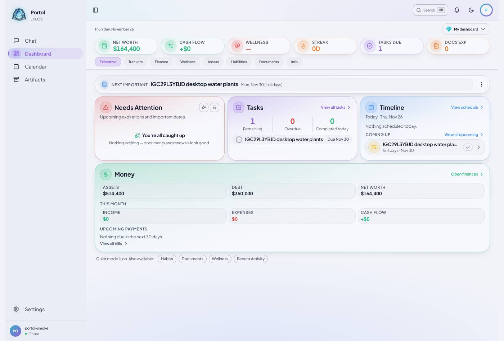

# Integrity report

Generated by `npx tsx scripts/gen-integrity-report.ts` from the last integrity run — do not edit by hand.
How the run works: `tests/integrity/README.md`. What depends on what, and the coverage matrix: `docs/INTEGRITY_MAP.md`.

**The rule this report is built on:** a scenario passes only when the action, the row read straight from the
database, the figures computed from it (checked against an independent calculation) and — where it has a
screen — a real browser all agree. A scenario that only saw a success answer is INCOMPLETE, not PASS.

## Summary

| | Before (portol.me @ 374c77a) | This run (portal-git-claude-gallant-knuth-3cr7u6-tronmooos-projects.vercel.app @ 3ef5ff1) |
|---|---:|---:|
| Scenarios passed | 33 | 51 |
| Scenarios failed | 5 | 0 |
| Scenarios incomplete (owed evidence) | 0 | 0 |
| Scenarios skipped | 0 | 0 |
| Checks made | 499 | 715 |
| …of the action | 109 | 143 |
| …of database rows | 193 | 315 |
| …of dependent figures (vs the oracle) | 135 | 169 |
| …in a browser (desktop + phone) | 27 | 53 |
| …of account isolation | 33 | 33 |
| Checks failed | 6 | 0 |
| Random seed | 20261127 | 20261203 |
| Run at | 2026-11-27 05:25 UTC | 2026-11-27 16:01 UTC |

**Local suite** (`npx vitest run`, runs on every push and pull request): 8394 of 8394 tests passed in 529 files. It includes the randomized oracle properties (`tests/integrity-oracle-properties.test.ts`), the model guard (`tests/integrity-model.test.ts`) and the guards for the fixes below.

**Existing live checks** (`tests/live-*-check.ts`; 46 of 46 were run): 34 passed against production as it is; the 12 that were red there were investigated one by one and rerun against the branch preview, where 11 now pass and **1 stays red on purpose**: `live-chat-variations-check` (125 of 139 phrasings pass; 14 fail (see the triage table)). The table below has each one. Nothing here is on production until the branch is merged.

## Found by the run, then fixed

Each was reproduced on production by the scenario named, root-caused, fixed, guarded by a local test that fails on the old code (`tests/integrity-run-fixes-2026-11-27.test.ts`) and rerun against the fixed deployment.

| Finding | Scenario | Before | Now |
|---|---|---|---|
| A loan-typed profile's balance is added to assets as well as debts assets moved by 20000 for a 20,000 loan; net worth is overstated by the balance | `money.legacy-loan-counted-once` | failed | **pass** |
| Deleting a profile leaves its characteristic values behind preferences row details:profile:69106171-8ad2-485b-8549-3910707337aa survives the profile | `records.details` | failed | **pass** |
| income: amount as a list is accepted POST /api/incomes {"description":"IGC29L3IAQ3 x","amount":[5],"category":"salary","date":"2026-11-26"} → 201 | `hardening.refused-input-writes-nothing` | failed | **pass** |
| event: a blank name is accepted POST /api/events {"title":"   ","date":"2026-11-26"} → 201 | `hardening.refused-input-writes-nothing` | failed | **pass** |
| A note's title can be saved as "[object Object]" POST /api/notes {title: {…}} stored the title "[object Object]" | `hardening.unusual-text-round-trips` | failed | **pass** |
| Two occurrence marks written at the same moment: one is lost tags after both requests answered 2xx: ["recur:weekly","rskip:2026-12-15"] | `hardening.simultaneous-edits` | failed | **pass** |

Scenarios that failed before and pass now: `money.legacy-loan-counted-once`, `records.details`, `hardening.refused-input-writes-nothing`, `hardening.unusual-text-round-trips`, `hardening.simultaneous-edits`.

## The 12 live checks that were red on production, one by one

Each was investigated on its own. *defect* = a product bug, fixed on the branch and guarded; *outdated* = the assertion contradicted a later owner rule or a redesign and was brought in line with it (never loosened to pass); *flaky* = did not reproduce; *runner* = caused by the check runner itself; *open* = real behaviour, left for a product decision.

| Check | Verdict | What was found | What was done | Rerun on the branch preview |
|---|---|---|---|---|
| `live-assets-liabilities-ui-check` | defect | #20: a payment recorded from another client left a reopened loan's header on the old balance until a reload. Deterministic. Nothing told an open tab that anyone else had written; it trusted its copy for three minutes. | Fixed: every read carries the account's version map and the app re-reads the domains another device moved, on navigation, on return to the tab and twice a minute (client/src/lib/server-versions.ts). Guard: tests/server-versions.test.ts; live: browser.written-elsewhere. | **pass** — Passes on the fix. |
| `live-task-date-and-calendar-check` | outdated | "Calendar: the open task offers Mark as done" — the grid now opens the redesigned detail sheet, whose action is the "Mark complete" button; the check looked for the old dialog's checkbox. Deterministic since the redesign. | The check drives the sheet's own control and, because the sheet closes on completing, reopens the item to require it reads Completed and no longer offers completion. Its day-panel count and timeline assertions are unchanged. | **pass** — Passes with the check driving the redesigned sheet. |
| `live-autopay-scenarios-check` | outdated | Expected an "Overdue bill" alert for a monthly bill whose date passed yesterday. Rule A7 (owner, 2026-11-22, the day after the check was written) says a recurring bill's elapsed date is assumed paid and nothing reads overdue. | The assertion now requires NO overdue alert for it; the check's missed-payment assertions (the exception that does show) are unchanged. | **pass** — Passes with the A7 assertion (a recurring bill's elapsed date is not overdue). |
| `live-asset-overview-check` | outdated | "The Value card shows no confidence figure" searched the whole card. "Remove confidence" (2026-11-23) was about the value estimate; the lifecycle section (11-24) and the optimal disposal point (11-26) were later asked to state their own, inside the same card. | Narrowed to what was asked: the value estimate's own block carries no confidence figure. | **pass** — Passes. |
| `live-chat-variations-check` | defect + open + flaky | Not a timeout: it takes about 25 minutes (165 chat turns) and my runner stopped it at 7–9. Run to the end on production: 123 of 139 phrasings pass, 16 fail. (a) "remember that my library card number is 20418" was stored over an older memory — the key was the first three words. (b) A reply in Spanish claimed "guardado" for an expense the duplicate question had blocked — the unbacked-claim guard knew only English. (c) Seven failures are the duplicate guard asking before a second same-priced purchase that day (Rule 35, deliberate). (d) Three expect "Friday" said on a Friday to mean next week. (e) The rest are the model's reading of a correction ("oops, it was $45" made a second expense; "push it back a week" made a second event; a repeated "I meditated today" logged twice). | (a) fixed: a memory is keyed by its subject (shared/memory-key.ts, tests/memory-key.test.ts). (b) fixed: write claims are recognised in Spanish, Portuguese, French, German and Italian (tests/claim-check-languages.test.ts). (c) open question for the owner (known.ts). (d) the expectation is ambiguous on Fridays — not changed. (e) open: real chat behaviour, not fixed in this pass. | **fail** — Run to the end from a clean account: 125 of 139 phrasings pass (production: 123), 14 fail — and it stays red on purpose. 5 are the same-priced-purchase duplicate question (Rule 35; open question for the owner). 3 are "Friday" said on a Friday (the check expects next week, the app files today; ambiguous, not changed). 4 are corrections that leave a second record or undo too much ("oops, it was $45", "push it back a week", "no wait, I only did it once", the same habit said twice) — real chat behaviour, not fixed in this pass. 1 was a new defect, found here and fixed: a goal asked for under an existing title with a different target was answered "Goal set" with nothing stored (tests/goal-same-title-different-target.test.ts). 1 ("I got paid $2,400 today" answered "already logged") did not reproduce alone. The Spanish reply now says the expense was NOT saved, and the library-card memory is its own memory. |
| `live-content-workflows-check` | runner | "Stopped after 7 minutes" both times. It ran directly after chat-variations was killed, and waited on the smoke account's gate lock the killed check still held. | Passes alone on production (51 checks, under 4 minutes). The runner now frees the lock after stopping a check. | **pass** — Passes. |
| `live-exec-dashboards-check` | flaky | Once "Tagged Spend shows both purchases and their total", once "could not create an expense" — two different failures in two runs. | Passes alone on production (65 checks). The second failure is consistent with the duplicate guard meeting another check's leftover expense of the same amount that day; not established. | **pass** — First rerun failed in 7 s on "this looks like Lunch from today — log it again?": the chat-variations check had been stopped at the runner's cap and left ~25 expenses behind. The runner now wipes the test account after a check it stops. Passes on a clean account. |
| `live-dated-owner-check` | flaky | A browser timeout, twice. | Passes alone on production. Both failures followed a killed check holding the gate lock; likely the same runner cause, not established. | **pass** — First rerun failed at sign-in: the check hard-coded the production address while the API pointed at the preview. It now uses the configured address (as two other checks did not either). Passes. |
| `live-entry-edit-and-series-edit-check` | flaky | Its setup asks the chat to log a run to a new tracker, and twice the chat did not do it the way the check expects. | Passes alone on production (17 checks). The step under test (an edit re-derives pace) is deterministic; its setup depends on a model call. Not changed. | **pass** — First rerun failed for the same leftover reason: a "Running" tracker left behind took the run the check logs to a new tracker by name (recorded as an open question in known.ts). Passes on a clean account. |
| `live-artifacts-check` | flaky | A 30-second browser timeout scrolling to an element. | Passes on the preview (187 s). Slow rather than broken; not changed. | **pass** — Passes. |
| `live-journal-check` | flaky | "A name with no profile creates none and says so": the reply did say so; the count of new entries was off by one in that run. | Passes on the preview. Not reproduced. | **pass** — Passes. |
| `live-wellness-dashboard-check` | flaky + outdated + open | Its AI Builder assertions depend on what the model chooses: once it built the sleep card over a tracker named Sleep rather than the sleep measurement, once it chose "latest" where the check expects "total". Looking at the account for it turned up a separate discrepancy: /api/stats counts 9 trackers where /api/trackers lists 1. | Not changed (the choices are within what H8 allows the model). The tracker-count discrepancy is recorded in known.ts. | **pass** — One assertion was outdated: it expected the saved 90-day default after a reload, but since QA 2026-11-24 (H4) the range picked on the tabs rides in the address and a reload keeps it. The check now requires both: the reload keeps the picked range, and the tab opened with no range shows the saved default. Passes. |

## Failed scenarios (0)

None.
## Bugs open in this run (0)

None found.

## Calculation discrepancies (2)

- **Chat sometimes asks before a delete the person asked for directly** — The chat's instructions say a direct "delete X" counts as confirmation. About one delete in six still came back as "…Shall I go ahead?" (a tracker entry, a budget). Nothing is lost and a "yes" completes it; the chat scenarios answer once and hold the result to the same database check. Seen in: chat.habits-goals-trackers and chat.money-records, preview 143d076, 2026-11-27 (replies recorded in test-results).
- **The dashboard's tracker count includes trackers the tracker list does not show** — GET /api/stats counted 9 trackers for the smoke account while GET /api/trackers listed 1: eight live finance-shaped trackers ("Regression Probe finance …", from May) are counted but not listed. Two answers to "how many trackers" (Rule 1). Not changed: which of the two is intended is the owner's call. Seen in: production, 2026-11-27 (database rows vs /api/trackers vs /api/stats.totalTrackers).

## Synchronization problems (2)

- **Another device learns of a write on its next navigation, its return to the tab, or within 30 seconds — not instantly** — There is no push channel. Every read carries the account's version map and the app asks for it on each in-app navigation, on return to the tab and twice a minute (lib/server-versions.ts); a domain another device moved is then read again. A screen that is simply left open can therefore show the old value for up to ~30 s. Seen in: browser.written-elsewhere (measures both); client/src/App.tsx VersionWatch.
- **Another device's reads can be up to about two seconds behind a write** — The server's response cache is keyed by a data version each instance memoizes for ~2 s. The device that made the write carries the new version in its next requests and always reads fresh (0 stale of 384 reads, production, 2026-11-27). A different device, which has no such token, can be answered from the pre-write cache for up to ~2 s (17 of 64 dashboard-bootstrap reads immediately after a write). Seen in: production probe, 2026-11-27 (server/routes.ts VERSION_MEMO_MS).

Screenshot of the open finding (the task is stored as done; the dashboard still counts it as remaining):

## Performance

769 API calls timed (the request itself; time waiting out the write limit is not counted). Budget: 1.5 s.

| Call | Calls | Median | Worst |
|---|---:|---:|---:|
| `POST /documents` | 2 | 2238 ms | **2238 ms** |
| `POST /habits/:id/checkin` | 12 | 658 ms | **1930 ms** |
| `PATCH /liability-payments/:id` | 2 | 1752 ms | **1752 ms** |
| `DELETE /trackers/:id/entries/:id` | 3 | 1634 ms | **1647 ms** |
| `POST /expenses` | 30 | 476 ms | **1580 ms** |
| `POST /trackers` | 8 | 1055 ms | **1553 ms** |

AI Chat turns: 60, median 3.7 s, worst 8.0 s (a model call; judged by what it stored, not by this).

Screens (time from navigating to the screen being on the page, then to the network going quiet):

| Screen | Desktop shown | Desktop settled | Phone shown | Phone settled |
|---|---:|---:|---:|---:|
| `/dashboard` | 33 ms | 3035 ms | 53 ms | 3053 ms |
| `/finance` | 105 ms | 3106 ms | 19 ms | 3019 ms |
| `/tasks` | 28 ms | 3028 ms | 32 ms | 3032 ms |
| `/calendar` | 32 ms | 3032 ms | 33 ms | 3034 ms |
| `/habits` | 24 ms | 3025 ms | 19 ms | 3020 ms |
| `/journal` | 23 ms | 3023 ms | 18 ms | 3018 ms |
| `/goals` | 13 ms | 3015 ms | 11 ms | 3011 ms |
| `/wellness` | 22 ms | 3022 ms | 32 ms | 3033 ms |
| `/artifacts` | 33 ms | 3034 ms | 20 ms | 3022 ms |
| `/linked?tab=assets` | 40 ms | 3041 ms | 36 ms | 3037 ms |
| `/linked?tab=liabilities` | 33 ms | 3035 ms | 33 ms | 3034 ms |
| `/obligations` | 30 ms | 3032 ms | 24 ms | 3025 ms |
| `/chat` | 41 ms | 3042 ms | 59 ms | 3059 ms |
| `/details` | 15 ms | 3016 ms | 12 ms | 3012 ms |
| `/settings` | 70 ms | 3072 ms | 61 ms | 3062 ms |

## Passed scenarios (51)

| Scenario | Area | Checks (action / database / derived / screen / isolation) | Time |
|---|---|---|---:|
| `money.net-worth` — Net worth follows every asset, account and debt, each counted once | Net worth | 2 / 7 / 8 / 0 / 0 | 15 s |
| `money.legacy-loan-counted-once` — A loan-typed profile is a debt, never also an asset | Net worth | 1 / 1 / 2 / 0 / 0 | 5 s |
| `money.loan-payments` — Loan payments: interest once a month, principal off the balance, reversal restores everything | Liabilities | 7 / 18 / 13 / 0 / 0 | 23 s |
| `money.payoff-schedule` — A loan's next due date and calendar dates come from its payment day | Liabilities | 1 / 0 / 3 / 0 / 0 | 4 s |
| `money.bill-cycle` — A recurring bill: next date, pay, undo, skip — the series keeps its schedule | Bills & Auto Pay | 7 / 7 / 9 / 0 / 0 | 13 s |
| `money.autopay` — Auto Pay records nothing before the due day, and one payment on it | Bills & Auto Pay | 1 / 3 / 4 / 0 / 0 | 12 s |
| `money.budget` — Budget progress equals the month's spending in its category | Budgets & spending | 3 / 4 / 9 / 0 / 0 | 14 s |
| `money.deleted-bill-history` — Deleting a bill keeps the money already paid, named for the bill; the history goes only when asked | Bills & Auto Pay | 2 / 4 / 4 / 0 / 0 | 11 s |
| `records.task-lifecycle` — A task: create, edit one field, complete, delete, restore — list, calendar and counts agree | Tasks | 3 / 7 / 6 / 0 / 0 | 11 s |
| `records.task-recurring` — A repeating task: skipping one date keeps every later date; completing rolls to the next scheduled date | Tasks | 3 / 5 / 3 / 0 / 0 | 9 s |
| `records.event-series` — Repeating events across month ends, a leap day and the year boundary | Calendar | 2 / 4 / 5 / 0 / 0 | 8 s |
| `records.habit` — A habit: one check-in per day, the streak is counted from the check-ins, delete and restore | Habits | 3 / 4 / 3 / 0 / 0 | 13 s |
| `records.tracker` — A tracker: one per name, entries stored, an edit re-derives pace, delete takes its entries | Trackers | 3 / 7 / 2 / 0 / 0 | 11 s |
| `records.goal` — A goal: create, progress, delete, restore | Goals | 2 / 4 / 1 / 0 / 0 | 6 s |
| `records.journal-notes` — Journal and notes: several entries a day, an edit never touches another entry, versions are kept | Journal & notes | 2 / 9 / 3 / 0 / 0 | 12 s |
| `records.artifact` — An artifact: checklist ticks are stored, a duplicate is independent, a share link works signed out and stops when turned off | Documents & artifacts | 1 / 4 / 2 / 0 / 1 | 7 s |
| `records.document-alerts` — A document's expiration raises one alert; a newer document, a delete and a restore each change it | Documents & artifacts | 4 / 2 / 9 / 0 / 0 | 14 s |
| `records.details` — A characteristic: one definition per name, typed values, flags derived from the value | Record details | 5 / 5 / 2 / 0 / 0 | 10 s |
| `hardening.refused-input-writes-nothing` — Invalid values are refused with a reason, never a server error, and write nothing | Input validation | 8 / 8 / 0 / 0 / 0 | 16 s |
| `hardening.unusual-text-round-trips` — Unusual text (emoji, right-to-left, markup, quotes, very long) is stored exactly or refused — never mangled, never run | Input validation | 7 / 11 / 0 / 0 / 0 | 42 s |
| `hardening.failed-edit-is-atomic` — An edit with one bad field changes nothing; an edit of a missing record creates nothing | Failed and cancelled actions | 13 / 14 / 0 / 0 / 0 | 12 s |
| `hardening.simultaneous-edits` — Two edits at the same moment to different fields of one record both land | Concurrency | 1 / 4 / 0 / 0 / 0 | 10 s |
| `hardening.repeated-requests` — The same request sent many times at once makes one record where one is meant | Concurrency | 4 / 6 / 0 / 0 / 0 | 11 s |
| `hardening.interrupted-request` — A request cut off mid-flight leaves the record whole: fully applied or not at all, and a retry does not double it | Network interruption | 1 / 9 / 0 / 0 / 0 | 31 s |
| `hardening.account-isolation` — Another account cannot read, change or delete this account's records — through the app or the database | Account isolation | 1 / 14 / 0 / 0 / 32 | 55 s |
| `hardening.date-edges` — Month ends, the first and last day of a month, and a leap day land in the right month and on the right day | Date boundaries | 1 / 1 / 5 / 0 / 0 | 12 s |
| `assets.lifecycle` — Depreciation, salvage and the optimal disposal point hold together, and follow an edit | Asset lifecycle | 1 / 2 / 24 / 0 / 0 | 8 s |
| `assets.nested-and-costs` — A nested asset counts once; an expense belongs to the deepest asset it names; loan payments are not upkeep | Nested assets & cost of ownership | 2 / 4 / 7 / 0 / 0 | 13 s |
| `assets.shared-ownership` — A share of an asset or a loan counts as that share for each person, and the whole for everyone | Ownership | 4 / 5 / 8 / 0 / 0 | 13 s |
| `assets.person-cascade` — Deleting a person leaves no record pointing at them | Ownership | 5 / 3 / 0 / 0 / 0 | 10 s |
| `chat.create-edit-delete` — Chat creates, changes, completes and deletes records — one row each, and the right row | AI Chat | 1 / 8 / 3 / 0 / 0 | 42 s |
| `chat.cancelled-and-questions-write-nothing` — A request taken back in the same breath, and a plain question, change nothing | AI Chat | 1 / 2 / 0 / 0 / 0 | 25 s |
| `chat.debt` — Chat: one debt is one record; a payment is recorded once and the balance is the stored one | AI Chat | 1 / 3 / 2 / 0 / 0 | 18 s |
| `chat.names-journal-foods` — Chat: a name is not a new profile, a journal request saves the words, two foods are two entries | AI Chat | 1 / 4 / 0 / 0 / 0 | 23 s |
| `browser.task-form` — The task form (mouse and touch): saved once, on every screen without a reload, ticked off and stored | Browser | 2 / 4 / 0 / 14 / 0 | 14 s |
| `browser.expense-form` — The expense form (mouse and touch): stored once, in Finance and in the month's total, without a reload | Browser | 2 / 2 / 2 / 4 / 0 | 11 s |
| `browser.written-elsewhere` — A record written on another device appears here without a reload, and a reload never hides it | Browser | 2 / 3 / 0 / 12 / 0 | 80 s |
| `browser.offline` — With the network cut, a save is not reported as saved and nothing is stored; back online it saves once | Network interruption | 1 / 2 / 0 / 1 / 0 | 12 s |
| `browser.screens` — Every main screen opens on desktop and phone: in time, with no error, and nothing wider than the screen | Responsiveness & performance | 0 / 0 / 0 / 6 / 0 | 94 s |
| `browser.loan-payment-dialog` — The payment dialog (mouse and touch): a double press is one payment, a second payment is a second, and the header follows | Browser | 2 / 6 / 2 / 6 / 0 | 27 s |
| `browser.habit-and-journal` — Habits and the journal by hand (mouse and touch): made, checked, written and deleted — each stored once | Browser | 4 / 14 / 0 / 10 / 0 | 31 s |
| `sweep.payment-edit-and-status` — Editing a recorded loan payment re-splits it; marking it missed reverses it and says so | Liabilities | 3 / 7 / 4 / 0 / 0 | 10 s |
| `sweep.bill-edit-and-move` — A bill's amount, one occurrence's charge and one occurrence's date change that thing only | Bills & Auto Pay | 4 / 2 / 5 / 0 / 0 | 7 s |
| `sweep.ownership-links` — Removing one owner's link hands the whole thing back; the link rows say so | Ownership | 2 / 3 / 5 / 0 / 0 | 10 s |
| `sweep.income-and-budget-copy` — Income, paychecks and copying a month's budgets | Budgets & spending | 5 / 8 / 2 / 0 / 0 | 8 s |
| `sweep.series-pause-and-renames` — Pausing a series, renaming a habit and a tracker: stored, and nothing else moves | Calendar | 2 / 7 / 4 / 0 / 0 | 12 s |
| `sweep.memory-preferences-links` — Memories, a preference row and links between records: stored, changed and removed exactly | Records | 5 / 15 / 0 / 0 / 0 | 25 s |
| `sweep.statement-import` — A statement import: previewed without writing, committed once, undone whole | Bank data | 2 / 4 / 2 / 0 / 0 | 6 s |
| `chat.habits-goals-trackers` — Chat: habits, goals and trackers — created, used, changed and removed as rows | AI Chat | 1 / 14 / 1 / 0 / 0 | 67 s |
| `chat.money-records` — Chat: income, budgets, accounts, bills and debts — the rows, and the totals that follow | AI Chat | 1 / 16 / 5 / 0 / 0 | 77 s |
| `chat.notes-artifacts-tasks` — Chat: notes, journal edits, checklists and task changes — the right row each time | AI Chat | 1 / 15 / 0 / 0 / 0 | 66 s |

### Existing live checks

| Check | Result | Time |
|---|---|---:|
| `live-all-pages-check` | pass | 108 s |
| `live-artifacts-check` | pass | 55 s |
| `live-asset-lifecycle-check` | pass | 46 s |
| `live-asset-overview-check` | pass | 26 s |
| `live-asset-rollup-check` | pass | 11 s |
| `live-assets-liabilities-check` | pass | 36 s |
| `live-assets-liabilities-ui-check` | pass | 57 s |
| `live-autopay-check` | pass | 49 s |
| `live-autopay-scenarios-check` | pass | 54 s |
| `live-bills-ui-check` | pass | 27 s |
| `live-bills-workflows-check` | pass | 16 s |
| `live-calendar-trackers-ui-check` | pass | 37 s |
| `live-chat-ui-check` | pass | 50 s |
| `live-chat-variations-check` | **FAIL** — 125 of 139 phrasings pass; 14 fail (see the triage table) | 420 s |
| `live-content-workflows-check` | pass | 420 s |
| `live-daily-pages-ui-check` | pass | 181 s |
| `live-dashboard-consistency-check` | pass | 16 s |
| `live-dated-owner-check` | pass | 44 s |
| `live-debt-one-card-check` | pass | 20 s |
| `live-editors-mobile-check` | pass | 85 s |
| `live-entry-edit-and-series-edit-check` | pass | 11 s |
| `live-exec-dashboards-check` | pass | 65 s |
| `live-finance-workflows-check` | pass | 31 s |
| `live-goals-ui-check` | pass | 28 s |
| `live-input-variations-2-check` | pass | 52 s |
| `live-input-variations-check` | pass | 94 s |
| `live-journal-check` | pass | 94 s |
| `live-liability-forms-check` | pass | 19 s |
| `live-liability-payments-check` | pass | 30 s |
| `live-liability-profile-check` | pass | 42 s |
| `live-money-journal-ui-check` | pass | 33 s |
| `live-profile-account-workflows-check` | pass | 14 s |
| `live-profile-creation-check` | pass | 40 s |
| `live-qa-2026-11-24-check` | pass | 103 s |
| `live-qa-2026-11-24b-check` | pass | 47 s |
| `live-records-workflows-check` | pass | 48 s |
| `live-recurring-occurrence-check` | pass | 18 s |
| `live-schema-drift-check` | pass | 2 s |
| `live-scroll-check` | pass | 128 s |
| `live-settings-ui-check` | pass | 39 s |
| `live-task-date-and-calendar-check` | pass | 56 s |
| `live-touch-gestures-check` | pass | 86 s |
| `live-wellness-dashboard-check` | pass | 38 s |
| `live-workspace-ai-check` | pass | 162 s |
| `live-workspace-apps-check` | pass | 100 s |
| `live-workspaces-ui-check` | pass | 57 s |

## Untested workflows and remaining coverage gaps

Of the doors in the coverage matrix, **169** are verified by an integrity scenario that passed in the last recorded run.

**A scenario exists but did not pass in the last run (0):** none.

**No test of any kind (5):**

- Connected bank data & statement import · edit · API (`PATCH /api/finance/accounts/:id`, `PATCH /api/finance/transactions/:id`)
- Connected bank data & statement import · archive · API (`POST /api/finance/connections/:id/disconnect`)
- Connected bank data & statement import · transfer · API (`POST /api/finance/transfers/:id`)
- Connected bank data & statement import · complete · API (`POST /api/finance/connections/complete`)
- Dashboards, alerts and preferences · complete · API (`POST /api/onboarding/complete`)

**Named by an existing test, but not verified against the database by a scenario (40):** Loan / card payment · edit · Chat; Loan / card payment · delete · Chat; Loan / card payment · complete · Chat; Debt (loan, card, mortgage) · delete · Chat; Debt (loan, card, mortgage) · reschedule · API; Debt (loan, card, mortgage) · transfer · Chat; Debt (loan, card, mortgage) · cancel · Chat; Asset (owned thing) and its lifecycle · create · Chat; Asset (owned thing) and its lifecycle · edit · Chat; Asset (owned thing) and its lifecycle · delete · Chat; Asset (owned thing) and its lifecycle · transfer · Chat; Financial account (cash, card, brokerage) · delete · Chat; Connected bank data & statement import · edit · Chat; Income, paychecks and cash flow · complete · Chat; Budget · duplicate · Chat; Calendar event · complete · Chat; Tracker entry (a logged reading) · reschedule · Chat; Tracker entry (a logged reading) · cancel · Chat; Tracker · edit · Chat; Document (uploaded file) · create · Chat; Document (uploaded file) · edit · Chat; Document (uploaded file) · transfer · Chat; Artifact (checklist, report, document, sheet) · edit · Chat; Artifact (checklist, report, document, sheet) · duplicate · Chat; Characteristic (record detail) · edit · Chat; Dashboards, alerts and preferences · create · Chat; Dashboards, alerts and preferences · edit · Chat; Dashboards, alerts and preferences · cancel · Chat; Dashboards, alerts and preferences · complete · Chat; AI memory · edit · Chat; AI memory · cancel · API; Person, pet or provider profile · edit · Chat; Person, pet or provider profile · delete · Chat; Person, pet or provider profile · transfer · Chat; AI chat & search · create · API; AI chat & search · edit · Chat; AI chat & search · cancel · Chat; AI chat & search · complete · API; Account, sign-in, export / import · create · API; Account, sign-in, export / import · archive · API.

**Offered by a screen, but not driven by an integrity browser scenario (88):** the browser scenarios drive the task and expense forms, a save while offline, a record made on another device, and every main screen on desktop and phone. Every other form is exercised by the per-screen live browser checks in `docs/WORKFLOW_MATRIX.md`, which assert what the screen shows but not the stored row.

**Not covered by the integrity run at all:**

- Connected bank accounts (the provider session, sync, webhook) — needs a bank sandbox; only statement import is exercised, by `tests/live-finance-workflows-check.ts`.
- Uploading a real file and the AI extraction that follows (`/api/upload`, re-extract, Smart Fill) — the run creates documents with a 1×1 image and typed fields.
- The valuation engine's live web research and the lifecycle AI call — the run checks the engine's arithmetic on stored and typical figures, not the model's choice of assumptions.
- Workspace AI (document assist / review, notes and journal assistants, the reflection coach and its memory) — covered by `tests/live-workspace-ai-check.ts` and `tests/live-workspace-apps-check.ts`.
- Sign-up, password reset, account deletion and data export / import — never run against the shared smoke account by this suite.
- Chat variations beyond the commands in `tests/integrity/scenarios/chat.ts` — phrasing coverage is `tests/live-chat-variations-check.ts` and `tests/live-input-variations*-check.ts`.
- Load: the run is one user. The 60-writes-a-minute limit on the account is respected, not tested.
- The native iOS shell (Capacitor): the phone surface is a 390 px touch browser.

### Known limits and open questions

- **OPEN — chat: "log to a NEW tracker called X" goes into an existing tracker for that activity, and the reply names X** _(open question for the owner)_ — With a "Running" tracker already on the account, "Log to a new tracker called 'Jog QQ7Z': I ran 1.25 miles in 14 minutes" added the run to Running and answered "Logged Jog QQ7Z running, 1.25 mi…"; no tracker named Jog QQ7Z exists. With no Running tracker the same sentence creates the named one. Folding an activity into its canonical tracker is deliberate (Rule 11), but the person asked for a new one by name and the reply reads as if they got it. Not changed: which wins (the name asked for, or one tracker per activity) is the owner's call; the reply should at least name the tracker the entry went to. Seen in: tests/live-entry-edit-and-series-edit-check.ts on the preview, 2026-11-27; reproduced directly (the chat answer carried no tool results).
- **OPEN — chat: a budget for a category outside the fixed list is filed somewhere different each time** _(open question for the owner)_ — "Set a budget of $90 for gifts" was saved under Shopping; "raise my gifts budget to $120" then made a General budget of $120; "delete my gifts budget" deleted General. The budget tools tell the model the category MUST be one of fourteen names, so for anything else it picks one, and not the same one twice — and a delete then acts on the guess, which could remove a real General budget. The API itself keeps an unknown name as its own budget. Not changed: whether an unlisted category should be refused, asked about, mapped by a fixed table or allowed as its own budget is a product decision. Seen in: chat.money-records, preview a4f09e3, 2026-11-27 (replies recorded in test-results); server/ai-engine.ts set_budget / delete_budget.
- **OPEN — the duplicate guard asks before saving a second same-priced purchase on the same day** _(open question for the owner)_ — Rule 35 (documented and tested): same owner + same amount + same day with a DIFFERENT description is a possible duplicate, so the second is not saved until confirmed. In chat that means "$18 on a movie ticket" after "$18 pizza" is refused ("the server flagged an unexpected conflict"), and a message listing several purchases loses the ones whose amounts match something already logged that day ("$5 coffee, $12 lunch, $40 gas, $8 parking" saved two of four). Not changed: it is a deliberate rule; whether different descriptions should still ask is the owner's call. Seen in: tests/live-chat-variations-check.ts on production, 2026-11-27 (7 of its 16 failures); reproduced directly; shared/duplicate-guard.ts.
- **An emptied version history leaves an empty preferences row** — Deleting a note, journal entry or document empties its versions (the text is gone) but the row versions:<kind>:<id> stays with the value "[]". No text is kept; one small row per deleted record is. Seen in: records.journal-notes; server/content-versions.ts forgetVersions.
- **An income date given as a timestamp is accepted for its day, even when the time is not a real time** — POST /api/incomes with date "2026-11-27T25:99:00Z" is stored as 2026-11-27. The day is valid and is what is kept; the junk after it is ignored rather than refused. Seen in: first integrity run on production, 2026-11-27 (hardening.refused-input-writes-nothing).
- **The preview and production share one database** — A branch preview reads and writes the same Supabase project as production, so a live run against a preview still writes as the smoke account in the production database (under the same gate lock). There is no separate test database; isolation is by account, enforced by row-level security (verified by hardening.account-isolation). Seen in: tests/smoke/fixture/account.ts; hardening.account-isolation.

